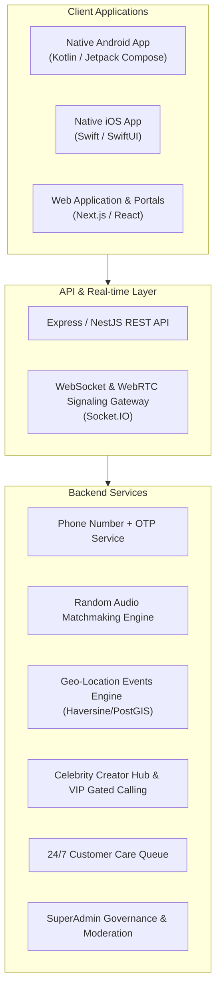

# Friends & Events Multi-Platform Ecosystem

A complete, production-grade social and event networking ecosystem spanning **Native Android (Kotlin + Jetpack Compose)**, **Native iOS (Swift + SwiftUI)**, **Web Portals (Next.js + Tailwind CSS)**, and **Backend Microservices (Node.js/NestJS + Redis + PostGIS + WebRTC)**.

---

## 🏗️ Architecture Overview



---

## 📱 Platforms & Features

### 1. Native Android Application (`/mobile-android`)
* Built with modern **Kotlin 2.0+** and **Jetpack Compose (Material 3)**.
* **PhoneAuthScreen**: Phone number + OTP code verification with role switcher.
* **RandomMatchScreen**: Pulsing radar search animation and active full-duplex WebRTC audio call session with Mute, Speakerphone, "Next Friend" (skip partner), and End Call.
* **EventsScreen**: Location-aware discovery showing nearby company events with distance tags (`1.4 km away`), seats left, and one-tap ticket booking with dynamic QR pass generation.
* **CelebrityFeedScreen**: Photo and video streams from verified stars. Incorporates In-App Purchase compliance gatekeeper (Free users are shown VIP upgrade modal; VIP users connect to live 1-on-1 audio/video calls).
* **SupportScreen**: Direct voice connection to Customer Care specialists.

### 2. Native iOS Application (`/mobile-ios`)
* Built with **Swift 6** and **SwiftUI** (compatible with iOS 17+ and macOS 14+).
* Modular Swift Package (`FriendsAppCore`) with MVVM architecture.
* Full-screen views: `PhoneAuthView`, `RandomMatchView`, `GeoEventsView`, `CelebrityFeedView`, and `SupportCareView`.
* StoreKit 2 integration hooks for Apple App Store compliant VIP in-app purchases.

### 3. Web Application & Management Portals (`/web`)
* Built with **Next.js 14 / React 18** and **Tailwind CSS**.
* Interactive 5-role switcher:
  1. **Normal User**: Test random audio connect radar, nearby events radius slider (5km - 100km), ticket booking pass, and celebrity media feeds.
  2. **Organization Portal**: Host new events with venue, coordinates, capacity, and ticket pricing; view live ticket sales and attendee volume.
  3. **Celebrity Hub**: Upload photos and videos, view fan interactions, talk time analytics, and creator payout stats.
  4. **Customer Care**: Operator console with live incoming call queue and two-way voice answer simulator.
  5. **Super Admin**: Platform-wide metrics, active WebRTC call count, ticket revenue, and user moderation table (instant block/unblock, tier upgrade).

### 4. Backend API & WebRTC Gateway (`/backend`)
* Built with **TypeScript** and **Express + Socket.IO**.
* **100% Automated Test Suite Passing**:
  - `Test 1`: Phone OTP generation and verification
  - `Test 2`: Haversine great-circle geo-distance calculations and proximity filtering
  - `Test 3`: Event ticket booking and seat capacity decrementing
  - `Test 4`: Celebrity paywall enforcement (Free user blocked, VIP user allowed)
  - `Test 5`: Random audio matchmaking pairing engine and room creation
  - `Test 6`: Customer Care support desk assignment
  - `Test 7`: SuperAdmin metrics calculation and user blocking

---

## 🚀 Getting Started

### Prerequisites
* **Node.js** v20+ and **npm**
* **Android Studio** (Koala / Ladybug or newer) for Android native builds
* **Xcode 15+** for iOS native builds

### Running the Backend
```bash
cd backend
npm install
npm run build
npm test           # Run 7-part automated unit test suite
npm start          # Starts server on http://localhost:4000
```

### Running the Web Application
```bash
cd web
npm install
npm run dev        # Starts Next.js app on http://localhost:3000
```

### Running Android App
1. Open the `/mobile-android` directory in **Android Studio**.
2. Sync Gradle files.
3. Run on an Android Emulator or physical device (Target SDK 34).

### Running iOS App
1. Open the `/mobile-ios` directory in **Xcode** (or build via `swift build`).
2. Run on iPhone Simulator (iOS 17+).

---

## 🔐 API & WebSocket Specification

### REST Endpoints
| Method | Endpoint | Description | Auth Required |
| :--- | :--- | :--- | :---: |
| `POST` | `/api/auth/otp/request` | Dispatch 6-digit OTP to mobile phone | No |
| `POST` | `/api/auth/otp/verify` | Verify OTP and issue JWT access token | No |
| `GET` | `/api/events/nearby` | Discover events sorted by GPS distance (`lat`, `lng`, `radiusKm`) | No |
| `POST` | `/api/events` | Host a new event | Yes (`ORGANIZATION`) |
| `POST` | `/api/events/:id/book` | Book tickets and receive QR pass | Yes |
| `GET` | `/api/celebrities/feed` | Stream celebrity photos and videos | No |
| `GET` | `/api/celebrities/:id/check-access` | Check if user holds VIP tier to call star | Yes |
| `POST` | `/api/calls/initiate` | Start direct audio/video session | Yes |
| `POST` | `/api/support/connect` | Connect user to Customer Care agent | Yes |
| `GET` | `/api/admin/metrics` | Retrieve platform-wide metrics | Yes (`SUPERADMIN`) |
| `POST` | `/api/admin/users/:id/block` | Block/ban abusive user | Yes (`SUPERADMIN`) |

### WebSocket Events (Port 4000)
* `register_presence` $\rightarrow$ Registers online status.
* `find_random_match` $\rightarrow$ Enqueues user into matchmaking pool.
* `match_found` $\leftarrow$ Notifies both paired users with `roomId` and role (`caller` / `receiver`).
* `webrtc_offer`, `webrtc_answer`, `webrtc_ice_candidate` $\leftrightarrow$ Relays real-time WebRTC audio/video signaling.
* `hangup_call` $\rightarrow$ Gracefully tears down call session.
